<div align="center">


<br>

[](https://macedo-hub.github.io/se7e/)
[](https://macedo-hub.github.io/se7e/pages/login.html)


**Uma loja de roupas online fictícia, feita como projeto avaliativo da disciplina de<br>Análise e Projetos de Sistemas — Curso Técnico em Informática, IFPB Campus Santa Luzia (2026).**

[Sobre](#-sobre-o-projeto) · [Telas](#-conheça-as-telas) · [Funcionalidades](#-o-que-dá-para-fazer) · [Como testar](#-como-testar-em-1-minuto) · [Estrutura](#-estrutura-do-projeto) · [Equipe](#-quem-fez-a-se7e)

</div>

---

## 💙 Sobre o projeto

A **SE7E** é uma loja de roupas online **inventada**: nenhuma compra é real e nenhum dado sai do seu navegador. O objetivo é simular o caminho completo de um e-commerce — da vitrine ao pedido, passando pelo painel de quem administra a loja — para colocar em prática o que foi estudado em Análise e Projetos de Sistemas.

O projeto será avaliado pelo professor **Elismar Moraes dos Santos**.

> [!NOTE]
> Tudo roda direto no navegador, só com HTML, CSS e JavaScript. Os dados (carrinho, pedidos, produtos editados no admin) ficam guardados no próprio navegador de quem está testando.

---

## 🖼️ Conheça as telas

<table>
  <tr>
    <td width="50%">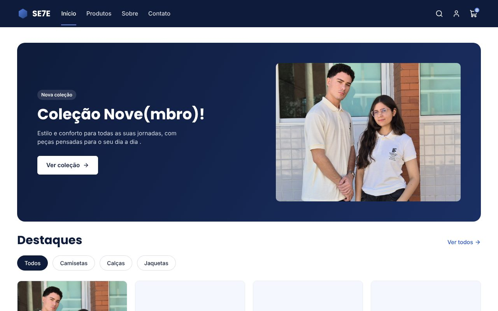<br><sub><b>Início</b> — banner, filtros por categoria e destaques</sub></td>
    <td width="50%">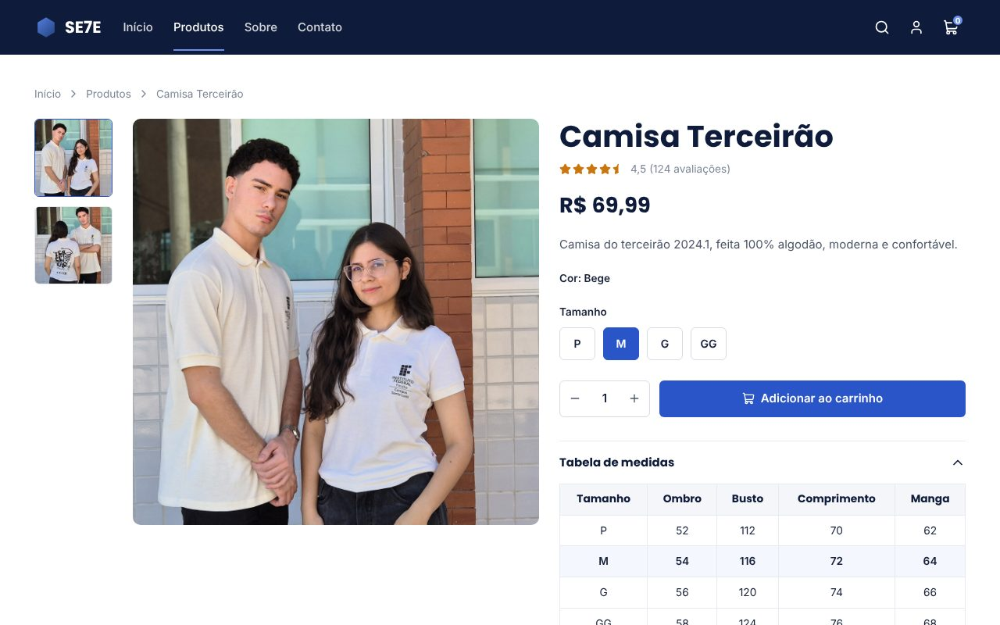<br><sub><b>Produto</b> — galeria, tamanhos e tabela de medidas</sub></td>
  </tr>
  <tr>
    <td width="50%">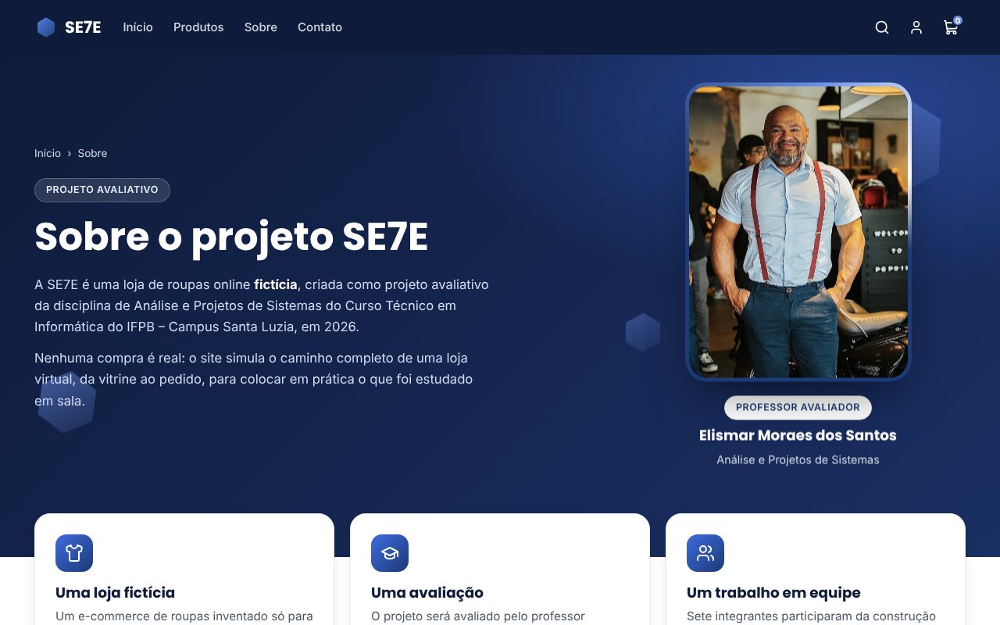<br><sub><b>Sobre</b> — o projeto, o professor avaliador e a equipe</sub></td>
    <td width="50%">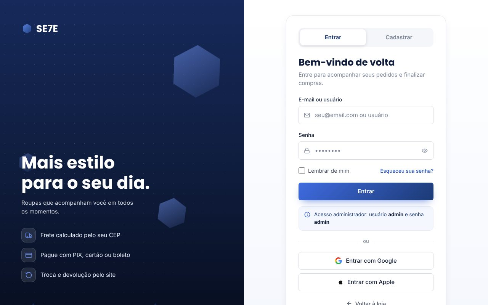<br><sub><b>Login e cadastro</b> — abas deslizantes e painel animado</sub></td>
  </tr>
</table>

<details>
<summary><b>📱 E no celular?</b> (clique para abrir)</summary>
<br>

O site foi conferido de **320px a 1440px**, sem rolagem lateral em nenhuma página. No celular, o menu vira um menu suspenso (fecha com `Esc` ou ao clicar fora).

<p align="center">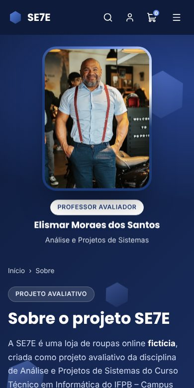</p>

</details>

---

## 🛍️ O que dá para fazer

<details open>
<summary><b>👤 Quem compra</b></summary>
<br>

| | Funcionalidade | Detalhe |
|---|---|---|
| 🧥 | **Ver produtos** | Catálogo com filtro por categoria (Camisetas, Calças, Jaquetas) |
| 📏 | **Escolher tamanho e cor** | Com tabela de medidas para consultar antes de decidir |
| 🛒 | **Montar o carrinho** | Alterar quantidades, remover itens, ver o subtotal |
| 🏷️ | **Aplicar cupom** | `DESCONTO10`, `DESCONTO15`, `DESCONTO20`, `DESCONTO30` e `DESCONTO50` (desconto em R$) |
| 🚚 | **Calcular frete** | Informando o CEP |
| 💳 | **Pagar** | PIX, cartão ou boleto (tudo simulado) |
| 📦 | **Acompanhar o pedido** | Status da entrega e código de rastreio |
| 🔄 | **Pedir troca ou devolução** | Formulário de solicitação |
| ✉️ | **Falar com a loja** | Página de contato |

</details>

<details open>
<summary><b>🛠️ Quem administra</b></summary>
<br>

| | Funcionalidade | Detalhe |
|---|---|---|
| 📚 | **Catálogo** | Cadastrar, editar e excluir produtos |
| 📊 | **Estoque** | Controlar entradas e saídas; o estoque baixa sozinho a cada pedido finalizado |
| 📈 | **Relatórios** | Vendas e desempenho da loja |
| 🙍 | **Perfil** | Dados do administrador |

> 🔑 **Entrar como administrador:** usuário `admin` · senha `admin`

</details>

### 🧭 O caminho de uma compra

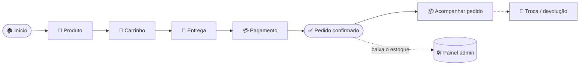

---

## 🚀 Como testar em 1 minuto

**Opção 1 — direto no navegador (mais fácil)**

👉 **<https://macedo-hub.github.io/se7e/>**

**Opção 2 — na sua máquina**

```bash
# 1. baixe o projeto
git clone https://github.com/macedo-hub/sete.git
cd sete

# 2. abra com um servidor simples (qualquer um serve)
python3 -m http.server 8000
```

Depois é só abrir <http://localhost:8000> no navegador. Também funciona dando dois cliques no `index.html`.

<details>
<summary><b>🎯 Roteiro sugerido para a avaliação</b></summary>
<br>

1. Abra a **Início** e filtre por categoria.
2. Entre em um **produto**, escolha o tamanho e veja a **tabela de medidas**.
3. Adicione ao **carrinho** e teste o cupom `DESCONTO10`.
4. Calcule o **frete**, escolha a forma de **pagamento** e finalize o pedido.
5. Confira o status em **Acompanhar pedido**.
6. Faça login como `admin` / `admin` e veja o pedido e o estoque no **painel administrativo**.
7. Abra a página **Sobre** e redimensione a janela para ver a responsividade.

</details>

---

## 🧩 Estrutura do projeto

```text
sete/
├── index.html              # Início: banner, filtros e destaques
├── pages/
│   ├── sobre.html          # O projeto, o professor e a equipe
│   ├── login.html          # Entrar e cadastrar
│   ├── produto.html        # Detalhe do produto
│   ├── carrinho.html       # Carrinho e cupom
│   ├── entrega.html        # Frete e endereço
│   ├── pagamento.html      # PIX, cartão ou boleto
│   ├── confirmacao.html    # Pedido confirmado
│   ├── pedido.html         # Acompanhar pedido
│   ├── troca.html          # Troca e devolução
│   ├── contato.html        # Fale com a loja
│   └── admin*.html         # Painel, catálogo, estoque, relatórios e perfil
├── css/
│   ├── reset.css
│   └── estilo.css          # Todo o visual (variáveis, componentes, responsividade)
├── js/
│   ├── produtos.js         # Dados dos produtos, cupons e armazenamento
│   ├── script.js           # Loja: menu, carrinho, login, animações
│   └── admin.js            # Painel do administrador
└── img/                    # Logo, ícones SVG, fotos da equipe e dos produtos
```

<details>
<summary><b>🎨 Detalhes de design</b></summary>
<br>

- **Paleta azul** definida em variáveis CSS (`--azul-900` a `--azul-50`), fácil de trocar em um só lugar.
- **Tipografia:** Poppins nos títulos e Inter no texto.
- **Ícones** em SVG, no estilo Lucide, na pasta `img/icones`.
- **Animações** discretas (entrada ao rolar, hexágonos flutuando, contagem de números) que respeitam a opção *reduzir movimento* do sistema.
- **Logo:** o hexágono da SE7E (`img/logo-hexagono.svg`).

</details>

<details>
<summary><b>💾 Onde ficam os dados?</b></summary>
<br>

Não há banco de dados nem servidor. O site usa o armazenamento do navegador:

| Dado | Onde |
|---|---|
| Produtos editados no admin, carrinho e pedidos | `localStorage` |
| Sessão (quem está logado) e cupom aplicado | `sessionStorage` |

Para voltar ao estado inicial, basta limpar os dados do site no navegador.

</details>

---

## 👩‍💻👨‍💻 Quem fez a SE7E

### Professor avaliador

<div align="center">
  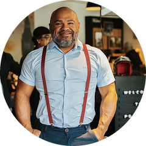<br>
  <b>Elismar Moraes dos Santos</b><br>
  <sub>Análise e Projetos de Sistemas · IFPB Campus Santa Luzia</sub>
</div>

### Equipe (em ordem alfabética)

<table align="center">
  <tr>
    <td align="center" width="25%"><br><b>Ana</b><br><sub>Sabrina de Souza Bulcão</sub></td>
    <td align="center" width="25%"><br><b>Angela</b><br><sub>Antonia Assis Medeiros</sub></td>
    <td align="center" width="25%"><br><b>Flávia</b><br><sub>Alexandra Mendes da Silva</sub></td>
    <td align="center" width="25%">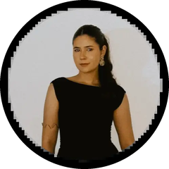<br><b>Iasmim</b><br><sub>Anahí Alves Silva</sub></td>
  </tr>
  <tr>
    <td align="center">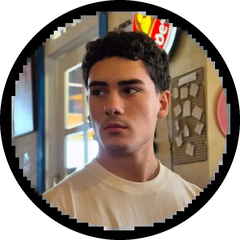<br><b>Lucas</b><br><sub>Emanuel Nóbrega de Macêdo</sub></td>
    <td align="center">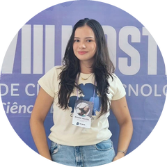<br><b>Maria</b><br><sub>Helisa Santos de Azevedo</sub></td>
    <td align="center"><br><b>Sabrina</b><br><sub>Yasmine Araújo da Silva</sub></td>
    <td></td>
  </tr>
</table>

---

## 📄 Licença

Distribuído sob a licença **MIT**. Veja o arquivo [`LICENSE`](LICENSE) para mais detalhes.

<div align="center">
  <br>
  <br>
  <sub><b>SE7E</b> · feito com 💙 por sete pessoas · IFPB Campus Santa Luzia · 2026</sub>
</div>
